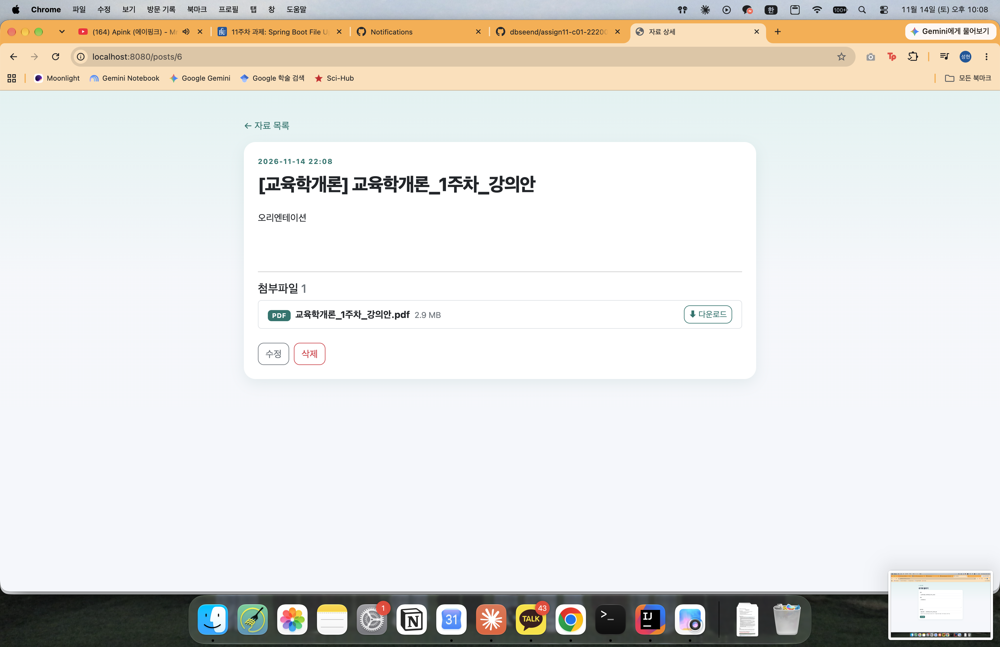
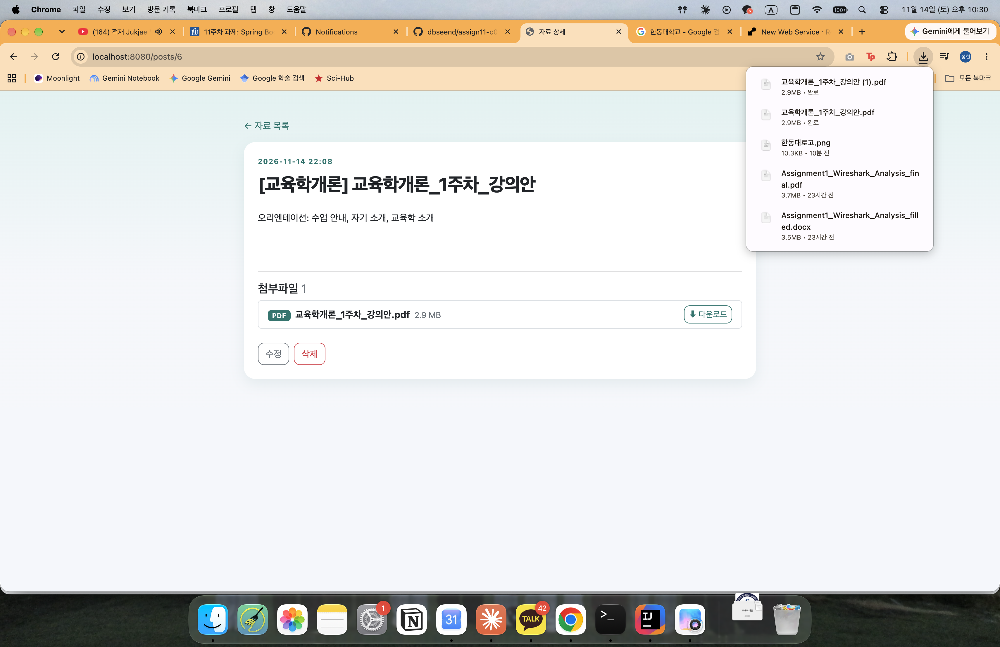
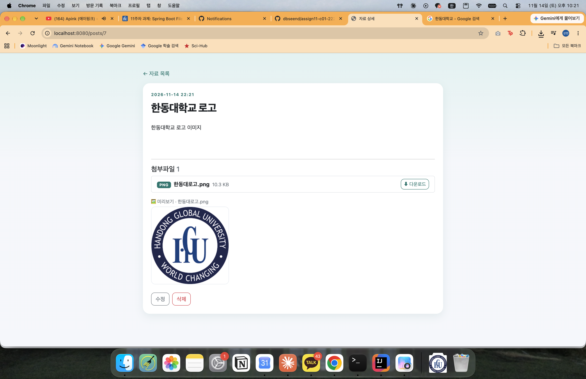
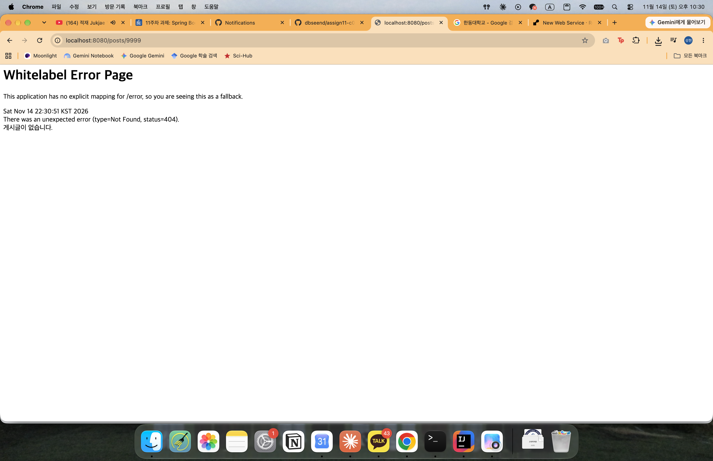
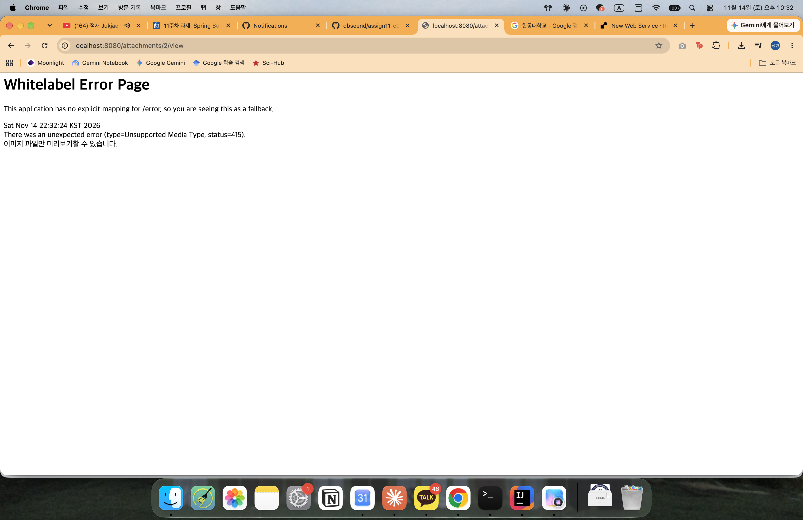
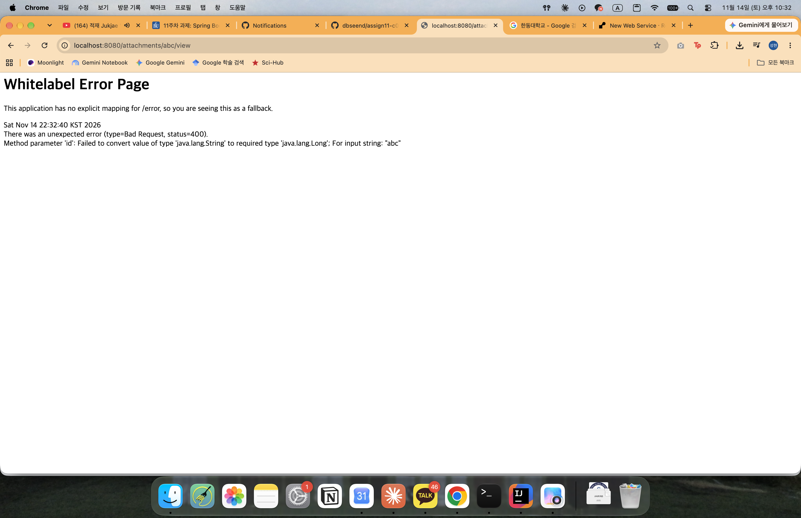
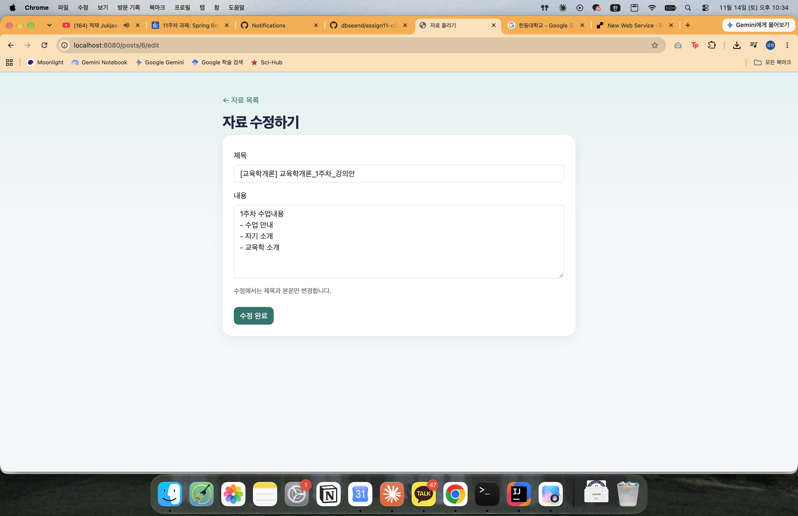
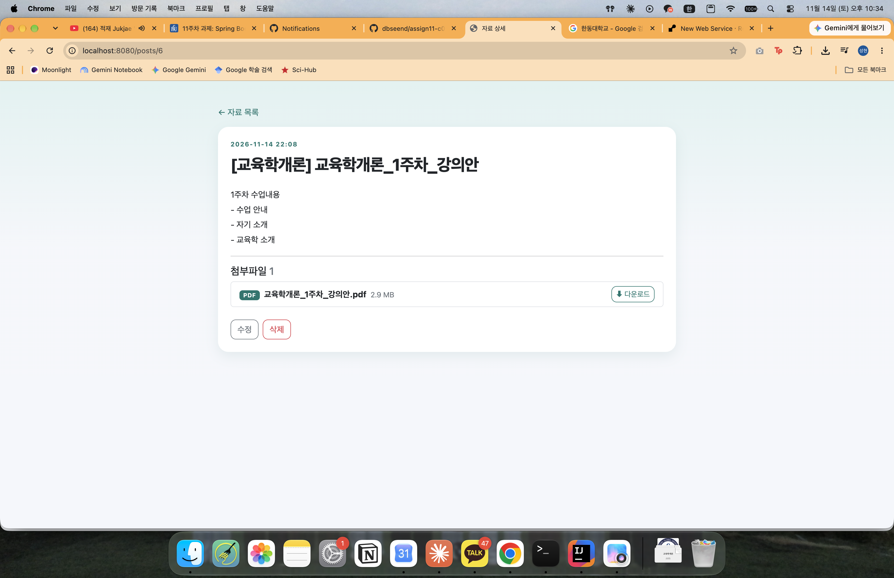
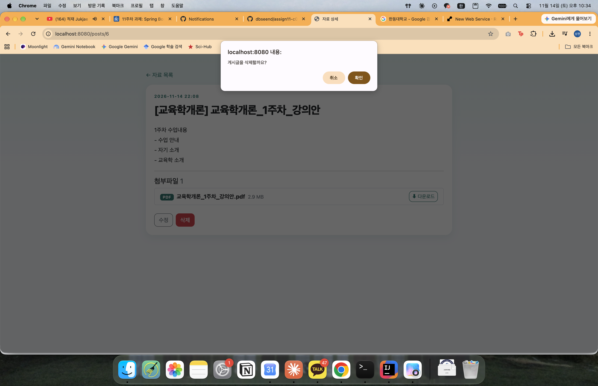
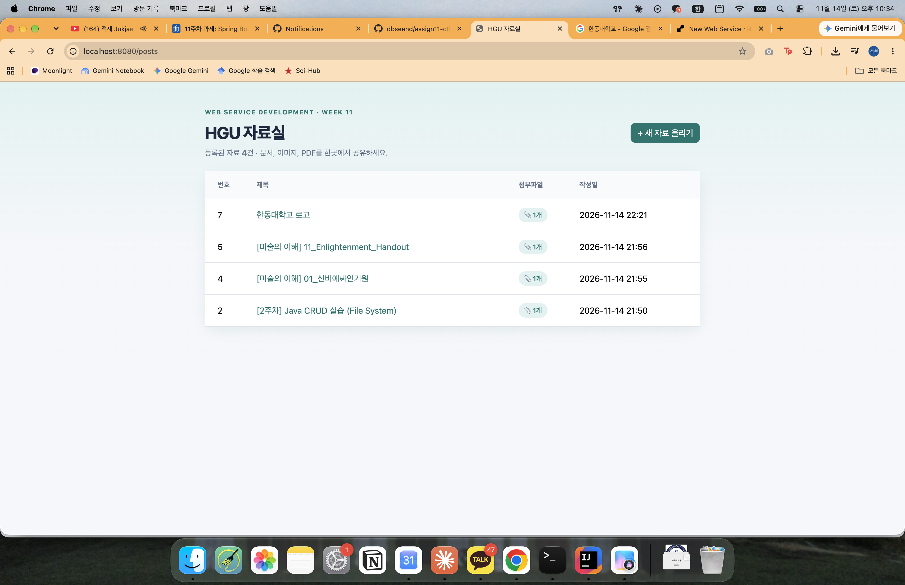

# Week 11 — Attachment Board (Student Sample)

Spring Boot + Thymeleaf + JPA + MariaDB: 게시글 CRUD / 다중 첨부파일 업로드 / 다운로드

## 실행하기
1. Java 17+ 및 MariaDB 준비, `CREATE DATABASE web11 CHARACTER SET utf8mb4;`
2. 환경변수 `DB_URL`, `DB_USERNAME`, `DB_PASSWORD`를 자신의 MariaDB에 맞게 설정. 기본값은 `jdbc:mariadb://localhost:3306/web11`, `webuser`, `webpass`.
3. Gradle이 설치된 환경: `gradle bootRun` / IntelliJ: `AttachmentBoardApplication.main()` 실행.
4. 접속: http://localhost:8080/posts

> Gradle Wrapper는 이 ZIP에 포함되어 있지 않습니다. IntelliJ의 Gradle 지원 또는 설치된 Gradle을 사용하세요. `gradle wrapper` 실행 후 생성된 wrapper 파일은 Git에 포함하는 것을 권장합니다.

## 구현된 기능
- 게시글 목록 / 생성 / 상세 / 수정 / 삭제
- 게시글 생성 시 여러 파일 선택, UUID 이름으로 `uploads/`에 저장
- `attachments` 테이블에 메타데이터 저장
- 첨부파일 다운로드 (`GET /attachments/{id}/download`)

## 학생 과제 (TODO)
1. 코드를 분석하여 업로드/다운로드 요청 흐름 정리
2. 화면이나 정보 표시 3곳 이상 수정
3. **이미지 미리보기** 구현: `GET /attachments/{id}/view` + 상세 화면 `` 표시. 이미지(jpg/jpeg/png/gif)만 허용하고 `Content-Type` 정확히 설정
4. 정상/오류 테스트 후 README 및 Weekly Review 작성

## 코드 위치
- `PostController`: 게시글 화면 / Form
- `AttachmentController`: 다운로드 + 미리보기 TODO
- `PostService`: JPA CRUD와 파일 저장 연결
- `FileStorageService`: 파일 검증 / UUID 저장 / 로드
- `Post`, `Attachment`: 1:N 관계
- `templates/posts/detail.html`: 미리보기 TODO

## 주의사항
- 학습용 프로젝트입니다. 로그인/접근 권한, 업로드 파일의 실제 바이트 검증, 악성 파일 검사, CSRF 보호, 파일 저장과 DB 트랜잭션의 완전한 일관성 보장 등은 구현하지 않았습니다. 인터넷 공개 배포 전에 보강이 필요합니다.
- `spring.jpa.hibernate.ddl-auto=update`는 학습용 설정이며 운영 DB에는 그대로 사용하지 않습니다.
- Render 기본 파일 시스템에 저장된 업로드 파일은 재시작/재배포 시 유지되지 않을 수 있습니다. 이번 과제는 **로컬 파일 처리**를 평가합니다.

## 3. Source Code Exploration & Analysis

### Project Structure & Spring MVC
- 참조 소스파일: PostController.java, PostService.java, PostRepository.java

1. PostController, PostService, PostRepository는 각각 어떤 역할을 하며, 서로 어떻게 연결되는가?
   - PostController는 파일 관련 CRUD 요청을 처리하는 컨트롤러로, 파일 업로드·수정·삭제와 업로드된 파일의 목록 조회·상세 조회를 담당한다.
   - PostService는 컨트롤러가 요청한 기능을 실제로 수행하는 비즈니스 로직을 담당한다.
   - PostRepository는 서비스의 비즈니스 로직을 거친 뒤, 데이터베이스에 파일 관련 데이터를 저장하고 조회하는 역할을 담당한다.
   - Controller → Service → Repository로 이어지는 계층별 역할 분리를 통해 계층 간 결합도를 낮추고 모듈화를 달성한다.

2. 게시글 작성 시 HTML Form의 입력값과 첨부파일은 Controller에 어떻게 전달되는가?
   - HTML Form은 title, content, 첨부파일을 입력받으며, 이 값들은 멀티파트(multipart/form-data) 형식으로 Controller에 전달된다.

### JPA & Entity Relationship
- 참조 소스파일: Post.java, Attachment.java

1. Post와 Attachment Entity는 어떤 관계이며, @ManyToOne과 @OneToMany는 각각 어떤 역할을 하는가?
   - Post는 게시물, Attachment는 게시물에 첨부되는 파일을 나타낸다.
   - 하나의 게시물은 여러 개의 첨부파일을 가질 수 있고, 하나의 첨부파일은 하나의 게시물에만 속하므로 Post와 Attachment는 일대다(1:N) 관계이다.
   - @OneToMany는 Post에 선언하여 Attachment와 매핑하고, @ManyToOne은 Attachment에 선언한다. 이에 따라 데이터베이스에서 Post의 PK가 Attachment의 FK로 들어가 관계가 형성된다.

2. cascade = CascadeType.ALL과 orphanRemoval = true는 어떤 역할을 하며, 실제 디스크에 저장된 파일에도 영향을 주는가?
   - cascade = CascadeType.ALL은 부모 엔티티의 영속성 상태 변화(저장, 수정, 삭제 등)를 자식 엔티티에도 동일하게 적용한다.
   - orphanRemoval = true는 부모(Post)와의 연관관계가 끊어진 자식(Attachment)을 자동으로 삭제하도록 지정하는 옵션이다. 부모가 삭제될 때도 자식이 함께 삭제된다.
   - 두 옵션 모두 JPA가 관리하는 데이터베이스에만 영향을 주며, 실제 디스크에 저장된 파일에는 영향을 주지 않는다.

### File Upload
- 참조 소스파일: PostController.java, FileStorage.java

1. MultipartFile은 무엇이며, 업로드된 파일은 어떤 과정을 거쳐 서버에 저장되는가?
   - MultipartFile은 Spring MVC에서 업로드된 파일을 처리하기 위한 인터페이스이다.
   - 업로드된 파일은 Controller에서 멀티파트로 수신하고, Service에서 검증을 거친 뒤, 스토리지에 실제 파일을 저장하고 데이터베이스에 파일 메타데이터를 저장하는 순서로 처리된다.

2. 파일을 원본 이름 대신 UUID 기반 파일명으로 저장하는 이유는 무엇인가?
   - 파일 수정이나 중복 업로드 시 파일명이 겹쳐 발생하는 데이터 손실과 관리상의 어려움을 방지하기 위함이다.

### File Download & Security
- 참조 소스파일: PostController.java, AttachmentController.java, FileStorage.java

1. 파일 다운로드 시 Resource, ResponseEntity, Content-Disposition은 각각 어떤 역할을 하는가?
   - Resource: 다운로드할 파일 데이터를 제공한다.
   - ResponseEntity: HTTP 응답(상태 코드, 헤더, 본문)을 구성하여 파일 다운로드 결과에 맞는 응답을 반환한다.
   - Content-Disposition: 다운로드 동작 방식과 파일명을 지정한다.

2. 파일 저장 과정에서 normalize()와 startsWith()를 사용하는 이유는 무엇인가?
   - Path Traversal 공격을 방어하기 위해서이다. 지정된 업로드 디렉터리 밖에 악성 파일이 저장되거나 기존 파일이 덮어씌워지는 보안 사고를 막는다.

## 4. Customizing
### 수정 내용
1. Text
- 목록 제목: 자료 공유 게시판 → HGU 자료실
- 목록 버튼: 게시글 작성 → 새 자료 올리기
- 폼 제목: 게시글 작성/수정 → 새 자료 올리기/자료 수정하기
- 폼 버튼: 저장 → 자료 등록/수정 완료
- 업로드 안내 문구를 “📎 업로드 가능: … · 여러 파일 동시 선택 가능”으로 보강

2. Style (app.css)
- 배경: 단색 → 민트 그라디언트
- 포인트 색: 파랑 → teal  #0f766e (버튼, 링크)
- 카드 모서리 20px + 그림자, 목록 최대 폭 960px

3. UI/Data
- 파일 크기: 9096 KB → 2.9 MB / 99.3 KB (자동 단위 전환)
- 파일명 앞에 확장자 배지(PDF) 추가
- 목록 첨부 개수: 1개 → 📎 1개 배지, 헤더에 등록된 자료 N건 표시

### 수정 전
- 목록 페이지

- 작성폼 페이지

- 상세 페이지

- 수정 페이지

## 수정 후
- 목록 페이지

- 작성폼 페이지

- 상세 페이지

- 수정 페이지

## 5. New Feature
### 구현 내용
- 상세 화면에서 첨부 이미지(jpg, jpeg, png, gif)를 미리보기 표시
- PDF, TXT 등 이미지가 아닌 파일은 미리보기 없이 기존 다운로드 버튼 유지
- 존재하지 않는 파일과 잘못된 ID는 오류 응답 처리

### 요청 흐름
- 상세 화면 로드 → 이미지 첨부마다 /attachments/{id}/view 호출
- Controller가 Repository에서 메타데이터 조회 → 이미지 타입 확인 → FileStorageService.load()로 Resource 생성
- ResponseEntity로 Content-Type(image/jpeg, png, gif)과 Content-Disposition: inline을 설정해 응답

### 수정 파일
- AttachmentController.java: GET /attachments/{id}/view 추가
- detail.html: 이미지 첨부에 한해 이미지 미리포기 표시
- app.css: .preview-img 스타일 추가

## Testing
### 필수 스크린샷
- Sample Project 초기 실행 (Customizing 이전) 

- 파일 업로드

- 파일 다운로드

- 이미지 미리보기

### 오류 처리
- /posts/9999 (없는 게시글)

- PDF의 /attachments/{id}/view

- /attachments/abc/view (숫자가 아닌 ID)

- /attachments/9999/view (없는 파일)

### 게시물 CRUD
- 수정 폼

- 수정 결과

- 삭제 확인

- 삭제 결과
